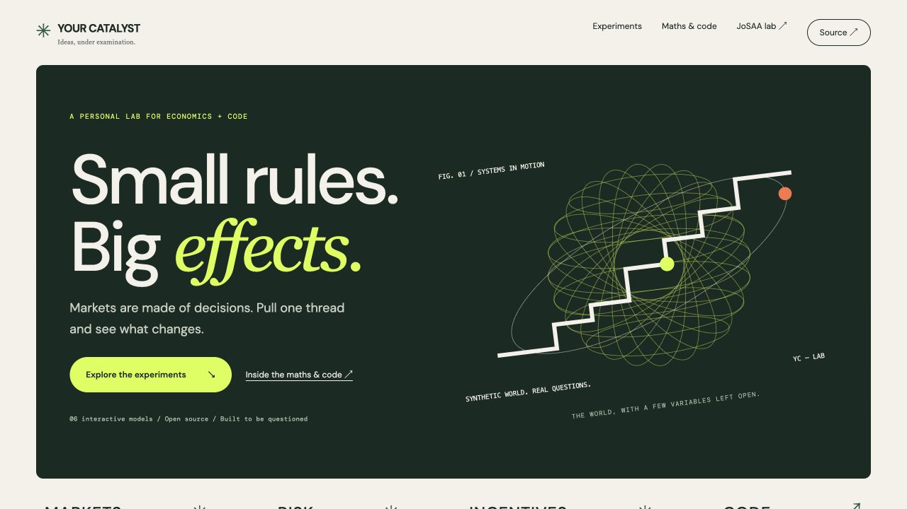
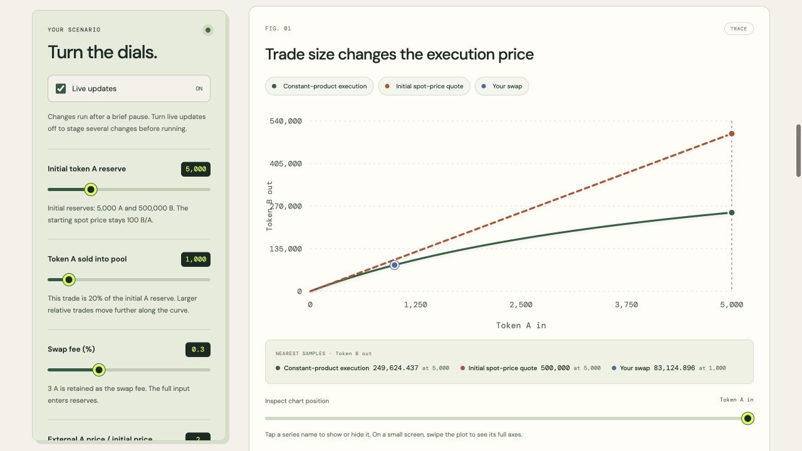
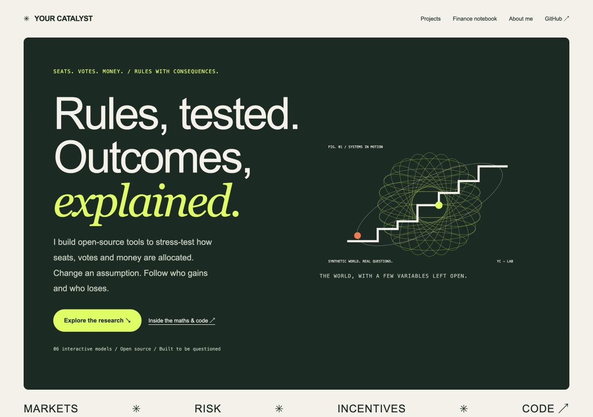

# Catalyst Lab — markets, risk & mechanism design

## Run locally in 2 commands

From a cloned checkout with Python 3.9+, install the test dependency and run the Python checks:

```sh
python3 -m pip install pytest==8.4.2
python3 -m pytest -q
```

The Python suite has **15 tests**. The browser notebook needs no npm packages or build step: serve it with `python3 -m http.server 8765` and open `http://localhost:8765/experiments/`. With Node 22+, run its 51 JavaScript checks using `node --test experiments/*.test.mjs allocation/*.test.mjs`.

## The 60-second research path

1. **DAO governance:** [Sharvina’s SSRN preprint](https://papers.ssrn.com/sol3/papers.cfm?abstract_id=7103878) reports changed winners in **4/15 selected proposals** under fixed-vote square-root reweighting. Editorial criticism of its novelty and fixed-distribution assumption prompted the [Sybil follow-up](https://github.com/thetarocks/dao-sybil-resilience). This is a preprint and subsequent analytical study, not peer-reviewed acceptance.
2. **JoSAA:** early Freeze forfeits one preference tier in **50/50 paired trials for one synthetic applicant**, repeatedly sampling four possible withdrawals. [Trial-level evidence](evidence/josaa-dynamic.json) makes the narrow scope inspectable; it is not a population estimate.
3. **Engineering:** a higher-priority displacement could update a program list without updating the winning applicant’s state. The Codex-assisted repair has a [regression checking both sides](tests/test_da.py).

[Who designed, implemented, analyzed and wrote what](docs/contributions.md) separates Sharvina’s original research from the later AI-assisted extensions. Private editorial criticism is author-reported; independent replication or acceptance is not claimed. The six browser finance models below are **one educational computational laboratory implementing established models**, not six additional research papers.

An open-source notebook connecting economic rules to inspectable algorithms, interactive counterfactuals and numerical checks.

**[Run the experiments](https://lab.yourcatalyst.in/experiments/) · [Read the maths & code guide](https://lab.yourcatalyst.in/experiments/learn.html) · [Visit Your Catalyst](https://yourcatalyst.in/)**



| Experiment | Mathematics & code | Try it |
| --- | --- | --- |
| Order-book execution | Price–time matching, partial fills, VWAP | [Simulator](https://lab.yourcatalyst.in/experiments/#orderbook) · [Explanation](https://lab.yourcatalyst.in/experiments/learn.html#orderbook) |
| Automated market makers | Constant-product swaps, reserve invariants, LP divergence | [Simulator](https://lab.yourcatalyst.in/experiments/#amm) · [Explanation](https://lab.yourcatalyst.in/experiments/learn.html#amm) |
| Discrete delta hedging | Black–Scholes, GBM paths, a self-financing ledger | [Simulator](https://lab.yourcatalyst.in/experiments/#hedge) · [Explanation](https://lab.yourcatalyst.in/experiments/learn.html#hedge) |
| Portfolio tail risk | Correlated sampling, standardized Student-t shocks, VaR/ES | [Simulator](https://lab.yourcatalyst.in/experiments/#risk) · [Explanation](https://lab.yourcatalyst.in/experiments/learn.html#risk) |
| Interbank contagion | Directed liabilities, proportional clearing, fixed-point iteration | [Simulator](https://lab.yourcatalyst.in/experiments/#contagion) · [Explanation](https://lab.yourcatalyst.in/experiments/learn.html#contagion) |
| Auction design | Reserve-aware equilibrium bids and paired Monte Carlo | [Simulator](https://lab.yourcatalyst.in/experiments/#auctions) · [Explanation](https://lab.yourcatalyst.in/experiments/learn.html#auctions) |

The browser models use synthetic inputs and established theory. Each includes assumptions, a worked example, primary references, numerical exports and validation. The [companion guide](experiments/learn.html) also covers algorithms, complexity, interpretation and possible extensions. [Implementation and reproducibility notes](experiments/README.md) describe the kernels and the use of coding assistance.

The experiment workspaces include debounced live controls, contextual explanations, pinned metric baselines, animated charts, mouse/touch/keyboard inspection, series toggles and selectable bank obligations. Live mode can be paused; exports always describe completed runs. Baselines and chart-visibility choices remain in browser memory and reset on a new visit.



The interface uses original SVG studies of each mechanism, a working order-book preview, searchable experiment collections and a companion guide with section tracking and reading progress. Motion respects reduced-motion preferences. The illustrations are visual identities, separate from the numerical charts.



## Launch the allocation model

The [JoSAA-inspired teaching simulator](https://lab.yourcatalyst.in/) renders a populated vacancy chain immediately. Float, Freeze, Slide and no-withdrawal presets compare deterministic three-applicant cases. [The browser kernel](allocation/model.mjs) runs student-proposing DA with strict common priorities; [six executable fixtures](allocation/fixtures.mjs) check capacity, acceptable matches, baseline envy, displacement state, multi-round choices and a one-program quota choice. The inspector re-runs those fixtures in the browser and links to CI.

The browser fixture suite is separate from the Python audit. Green fixture checks do not prove DSIC, general quota monotonicity or official-rule equivalence. The published 50/50 result concerns one synthetic applicant and repeated sampling of four possible withdrawals; it is not a population regret estimate. The proposal to preview Freeze consequences is an interface hypothesis awaiting user testing.

## Research and evidence

- **JoSAA:** 0 profitable deviations across **1,080** finite preference perturbations (60 synthetic applicants, 17 programs). DSIC for applicant-proposing DA in a single round is established theory; this is an implementation check, not a new proof.
- **Multi-round contribution:** for one selected applicant, freezing forfeits an upgrade in **50/50 paired trials**, with one upstream withdrawal per trial. These repeatedly sample only four possible withdrawal sets; this is not a population estimate. The audit performs 201 matching runs.
- **Data:** synthetic preferences and utilities generated from `data/raw/sample_josaa_cutoffs.csv`. Its official source/year are not documented; it must not be treated as verified real JoSAA data or actual submitted preferences.
- **DAO paper:** [Arbitrum governance counterfactuals on SSRN](https://papers.ssrn.com/sol3/papers.cfm?abstract_id=7103878). This preprint concerns fixed-vote square-root reweighting. The [Sybil follow-on](https://github.com/thetarocks/dao-sybil-resilience) is a separate analytical model; complete raw ballots are not archived here.

Read the [three-page JoSAA technical note](site/artifacts/josaa-technical-note.pdf), [two-page Sybil model note](site/artifacts/sybil-technical-note.pdf), [static evidence](evidence/josaa-static.json), [paired-trial evidence](evidence/josaa-dynamic.json), and [methods and limitations](docs/methods_and_limitations.md).

## Engineering decisions and a real regression

The portfolio starts with a question connected to politics: how do rules distribute representation, access and influence? The models make those choices inspectable through inputs, intermediate state and counterfactuals.

During development, a later higher-priority applicant could appear in the program’s accepted list while their own `current_match` remained empty. The repair updates retained applicants too. [The regression](tests/test_da.py) checks the winning program list, the winner’s state and the displaced applicant’s state together.

The pipeline is **sample inputs → synthetic preferences → matching → round actions → paired withdrawals → JSON evidence**. The browser notebook uses **seed + controls → pure model → chart / explanation / export**. Displayed prose and charts use the same completed result.

### Measured performance

The [local timing record](evidence/runtime.json) reports five wall-clock samples after warm-up on macOS ARM64 / Python 3.9.6. The static workload executes **1,081 matching runs in a 1.62 s median**; the dynamic workload executes **201 matching runs in a 140.0 ms median**. Measurements include market generation and source hashing. They are local workload timings, not browser or national-scale guarantees.

Re-run with `python3 -m scripts.benchmark_runtime --json evidence/runtime.json`. Array queues and repeated sorting remain optimization opportunities; no WebAssembly or Worker speedup is claimed.

The [archived DAO proposal metadata](evidence/arbitrum-proposals.json) contains 15 proposals and 866,320 reported votes across them, with recorded per-proposal Snapshot scores from 42.1m to 240.5m. These are proposal metadata counts; repeat participants are possible and scores are not dollar amounts. See the [aggregation and provenance](site/evidence/arbitrum-manifest-summary.json). This does not replace a frozen ballot-level archive or reproduce the paper independently.

## Explore the repository

- [Static portfolio source](site/) — Home, Projects, About, previews, PDFs and evidence; published through [yourcatalyst-site](https://github.com/thetarocks/yourcatalyst-site)
- [Python matching kernels](core/), [benchmark scripts](scripts/) and [Python tests](tests/)
- [Browser model kernels](experiments/models.mjs) and [numerical tests](experiments/models.test.mjs)
- [Live explanations](experiments/live-notes.mjs), [interactive charts](experiments/charts.mjs) and [presentation checks](experiments/presentation.test.mjs)
- [Finance notebook documentation](experiments/README.md) and [maths/code guide](experiments/learn.html)
- [Legacy WordPress markup](wordpress/) — retained as a migration backup

## Run and verify

No npm installation or build step is required for the browser notebook. Node 22+ runs the JavaScript checks.

```sh
python3 -m http.server 8765
# Visit http://localhost:8765/experiments/
node --test experiments/*.test.mjs allocation/*.test.mjs
python -m pip install pytest
python -m pytest -q
```

The validation workflow runs 51 JavaScript checks and 15 Python tests. Passing checks support implementation correctness under the stated assumptions; coverage has not been measured. They do not validate a market forecast or establish a new economic theorem.

[](https://github.com/thetarocks/catalyst-lab/actions/workflows/validate.yml)

Reproduce the audited results and portfolio:

```sh
python -m scripts.benchmark_manipulability --json evidence/josaa-static.json
python -m scripts.audit_dynamic_strategies --json evidence/josaa-dynamic.json
cp evidence/josaa-*.json site/evidence/
python scripts/build_portfolio.py
python3 -m http.server 8766 --directory site
# Visit http://localhost:8766/
# Optional PDF regeneration: pip install reportlab, then
python scripts/build_technical_notes.py
```

The Python DA implementation uses program-side sorting and a list queue; it is an inspectable small-market implementation, not an optimized national-scale allocator. Quota fixtures test the implemented vertical-quota rules; they do not establish equivalence to every official JoSAA rule. The browser sandbox has its own synthetic illustrative inputs, distinct from the Python benchmark cohorts. See the PDFs for exact scope and limitations.

The portfolio uses coding assistance; the intent is to make the equations, source, tests and evidence inspectable enough to explain and challenge. No real user testimonial, mentor endorsement or competition outcome is claimed without a verifiable source.
