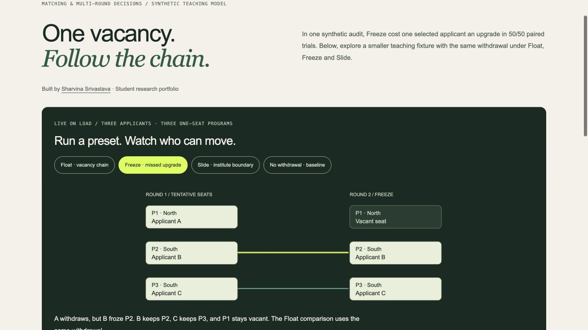

# Allocation teaching model and executable fixtures

Open the [live simulator](https://lab.yourcatalyst.in/) or serve the repository root with `python3 -m http.server 8765`.

- `model.mjs`: strict-priority student-proposing DA, the three-applicant two-round scenario, feasibility / acceptable-assignment / baseline-envy checks, and a one-program merit-first quota choice.
- `fixtures.mjs`: the six exact checks shown in the browser inspector.
- `suite.mjs`: executes those checks on load and on demand, with scope labels and links to the separate Python evidence.
- `app.mjs`: Float, Freeze, Slide and no-withdrawal presets; diagrams adapt to a stacked layout on phones.
- `model.test.mjs`: six shared fixture cases plus tests of action boundaries and intentionally corrupted assignments.

Run `node --test allocation/*.test.mjs` with Node 22+. No npm dependencies are needed. The website build copies the shared model, fixture and inspector modules to `site/assets/allocation/` so the portfolio runs independently on its own domain.

The browser example is deterministic and synthetic. It is distinct from the 80-applicant Python audit and its selected-applicant 50/50 finding. Fixture checks do not prove DSIC, quota monotonicity or equivalence to official JoSAA rules. The interface proposal to preview Freeze consequences awaits real user testing.

The earlier cutoff-only illustration remains recoverable in Git history. The current launch page uses an actual small DA model rather than rank-threshold lookup.
